  

 

  
  &nbsp;&nbsp;
  
  &nbsp;&nbsp;
  

 

  Full Stack Software Engineer with foundational expertise in architecting resilient backend services using <b>Java & Spring Boot</b>, designing decoupled RESTful APIs, and crafting fluid user interfaces with <b>React & TypeScript</b>. Experienced in taking real-world systems from concept to production across healthcare, hospitality, dairy management, and education.

---

### 📈 24/7 Live Contribution Activity

  <!-- Live Auto-Updating Contribution Graph Snake Animation -->
  

---

### 💻 Production & Live Implemented Projects

Selected commercial and client applications shipped with end-to-end architecture, responsive design, and production deployments:

| # | Client / Platform | Architectural Scope & Implementation | Verified Stack | Deployment |
| :-: | :--- | :--- | :--- | :---: |
| 01 | **Hotel Namrata** | Commercial hospitality portal offering responsive digital menus, dining reservation workflows, and banquet management. | `React` `Tailwind CSS` `Vercel` | [🔗 Live Demo](https://hotel-namrata1.vercel.app/) |
| 02 | **Dr. Borude Healthcare** | Clinical web portal facilitating patient appointments, treatment advisories, OPD schedule displays, and doctor profile management. | `React` `Tailwind CSS` `Production UI` | [🔗 Live Demo](https://dr-borude-website.vercel.app/) |
| 03 | **Shivneri Dairy Management** | Enterprise dairy SaaS dashboard managing milk collection, tiered pricing billing rules, and real-time inventory tracking. | `React` `Express.js` `Firebase` | [🔗 Live Demo](https://dairy-app-sepia.vercel.app/dashboard) |
| 04 | **CASAS Campus Navigator** | Interactive indoor and outdoor campus directory and navigational guide mapping academic facilities and points of interest. | `Kotlin` `Android SDK` `React` | [🔗 Live Demo](https://campus-navigator-bice.vercel.app/) |
| 05 | **Shivrakshak Career Academy** | Official educational institution web portal delivering career coaching curriculums, defense entrance exam modules, and student registrations. | `Next.js` `React` `Tailwind CSS` | [🔗 Live Demo](https://shivrakshakacademy.in/) |
| 06 | **Kailas Udupi Restaurant** | Commercial food and culinary platform showcasing restaurant services, interactive menus, customer feedback, and branding. | `React` `Vite` `Tailwind CSS` | [🔗 Live Demo](https://kailas-udupi.vercel.app/) |

---

### 🏛️ Technical Competencies & Architecture

#### Backend & Data Architecture

  
  
  
  
  
  
  
  

#### Frontend & Mobile Engineering

  
  
  
  
  
  
  

#### DevOps & Production Tooling

  
  
  
  
  
  

---

### 📊 Performance & Activity Analytics

  <!-- GitHub Readme Streak (Radical / Burgundy Palette) -->
  

 

  <!-- GitHub Stats (Fast Reliable Mirror) -->
  
  &nbsp;&nbsp;
  <!-- Top Languages Card -->
  

---

 

<!-- Minimal Impeccable Footer -->

  

